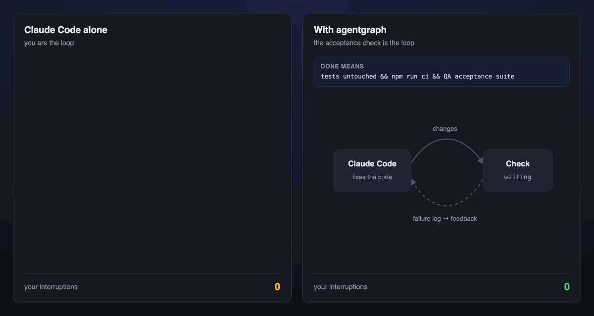
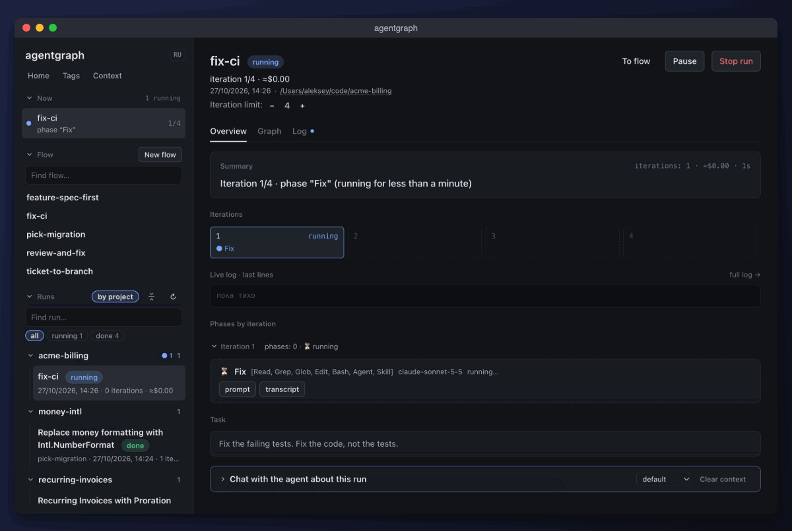
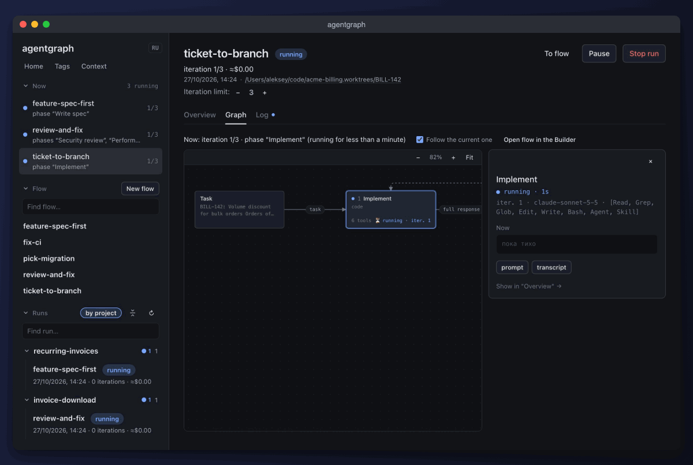
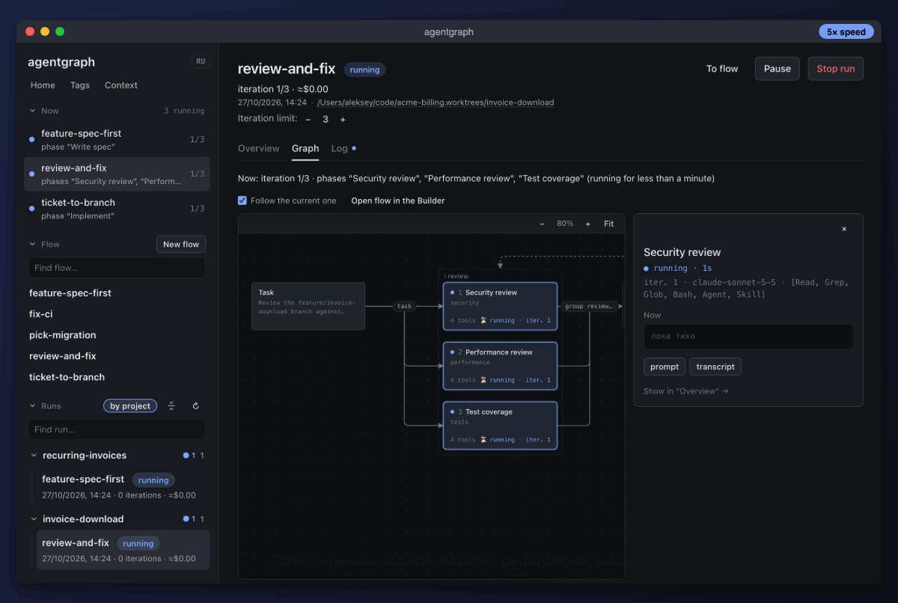
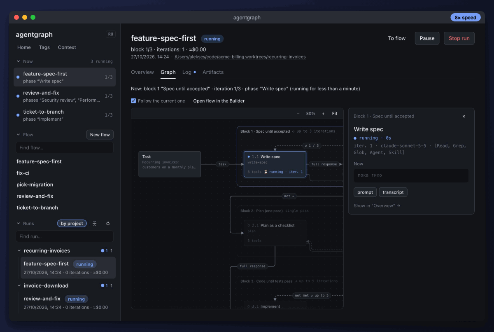
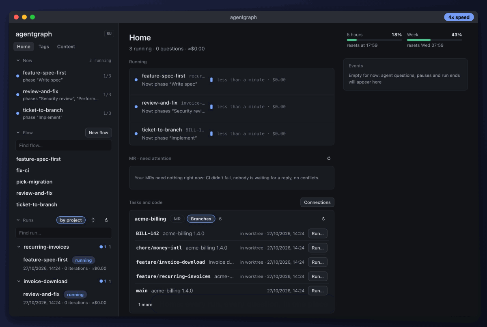
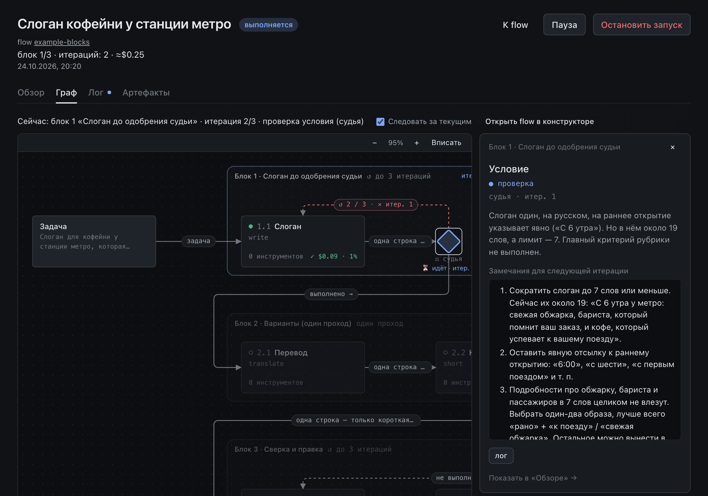
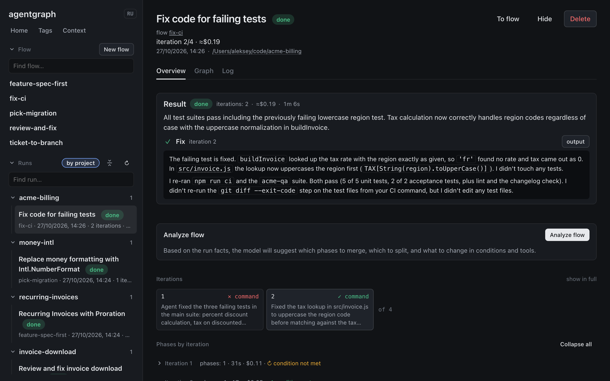
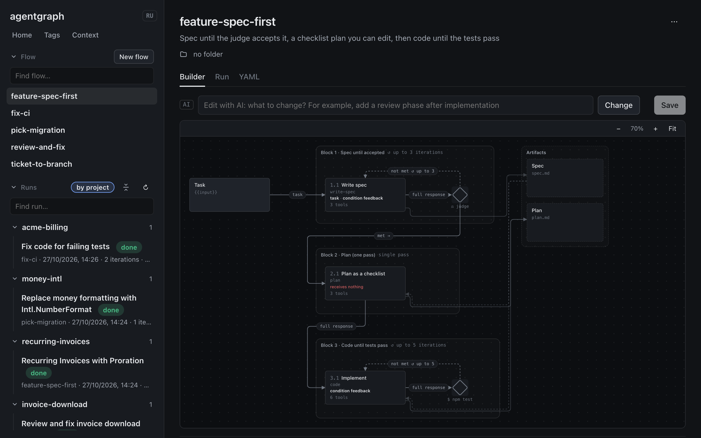

# agentgraph

[](https://github.com/alekseyKolodin/agentgraph/actions/workflows/ci.yml)

**Stop babysitting Claude Code.** Tell agentgraph what "done" means (CI is green, a reviewer approved, the ticket's acceptance criteria are met) and it keeps the agent working until that's true. When a check fails, its output goes back to the agent as feedback. You come back to a finished branch instead of "Done! Tests should pass now ✅".

<p align="center"></p>

Runs locally on your Claude Code subscription or API key: in the browser, as a macOS app, or from the CLI.

<p align="center">
  <a href="#use-cases">Use cases</a> ·
  <a href="#quick-start">Quick start</a> ·
  <a href="#how-it-works">How it works</a> ·
  <a href="docs/GETTING_STARTED.md">Guide</a> ·
  <a href="docs/REFERENCE.md">Reference</a>
</p>

| Today you… | With agentgraph |
|---|---|
| re-run tests after the agent says "fixed" and paste the log back | The check is a shell command. Its output becomes the next iteration's feedback, with no copy-paste |
| review every agent diff yourself first | A separate **read-only** reviewer that never saw the implementer's reasoning, plus a judge with your rubric |
| re-explain the feature in every new session | A **task tag** keeps a summary of the feature across runs: where the code is, decisions, what's left |
| juggle three terminals with three agents | One **Home** page: every run, every agent question, the PRs that need you; each run in its own git worktree |
| find out the agent burned $15 going in circles | Budget, turn and iteration limits per run and per phase, and a "stuck" warning when iterations fail the same way |
| can't reproduce the one great session you had | The process is a YAML file in git, and `/session-to-flow` turns a past session into one |

## Use cases

Every recording below is a real run of the flow next to it on a small billing service (`acme-billing`, Node, `node:test`). The recorded flows also set `model: sonnet` and phase titles. Long stretches are sped up, and the badge in the corner shows how much. Captions, zoom and the cursor in cuts between tabs were added in editing; everything inside the window is the actual UI.

### 1. Get CI green

After a refactor, CI on `release-1.5` is red. Iteration 1 fixes three bugs, and the unit tests and lint pass. CI still fails: the QA team's acceptance suite, which lives in another repo and isn't mentioned in the task, catches lowercase region codes. That log becomes the feedback for iteration 2, which fixes it.

<p align="center"></p>

<details>
<summary><b>flow.yaml</b>: one phase, and a check the agent can't talk its way past</summary>

```yaml
name: fix-ci
input: Fix the failing tests. Fix the code, not the tests.
defaults:
  max_budget_usd: 3
loop:
  max_iterations: 4
  until:
    type: command   # exit 0 = done; otherwise its output goes to {{feedback}}
    run: git diff --exit-code --stat -- '*.test.*' && npm run ci && node --test ~/code/acme-qa/*.test.js
phases:
  - name: fix
    tools: [Read, Grep, Glob, Edit, Bash]
    prompt: |
      {{input}}

      What failed on the last CI check (empty on the first iteration):
      {{feedback}}
```

`git diff --exit-code` on the test files turns "don't touch the tests" into a check that fails, so it no longer depends on the agent following a request.

</details>

You don't have to write this flow yourself: `npm run agentgraph -- "Fix the failing tests, don't change the tests" --cwd ~/code/my-repo --max-budget 3` generates one like it and runs it.

### 2. Jira ticket → reviewed branch

**Home → Tasks and code** lists your Jira sprint. **Run…** on a ticket puts its description, subtasks and links into the task. **Prepare worktree** gives the ticket its own branch and folder, so your main checkout stays untouched and several tickets can run at once. In the recording, the ticket text is the task and the branch is a worktree. An implementer writes the code and tests, a read-only reviewer checks the diff, and a judge goes through the acceptance criteria.

<p align="center"></p>

<details>
<summary><b>flow.yaml</b>: implement → read-only review → judge</summary>

```yaml
name: ticket-to-branch
loop:
  max_iterations: 3
  until:
    type: judge
    prompt: |
      Ticket: {{input}}
      Result: {{outputs}}
      done=true only if every acceptance criterion of the ticket is met and the tests pass;
      otherwise list what's missing in feedback.
phases:
  - name: code
    tools: [Read, Grep, Glob, Edit, Write, Bash]
    prompt: |
      {{input}}
      Review of the previous iteration (empty on the first): {{phases.review}}
      Judge feedback: {{feedback}}
      Implement the ticket, add tests, run them, commit.
  - name: review
    tools: [Read, Grep, Glob, Bash]   # no Edit: the reviewer can't quietly fix things
    prompt: |
      Review `git diff main...HEAD` against the ticket: {{input}}
      Look for bugs, missing edge cases, missing tests. Be specific: file, line, why.
```

The reviewer is a separate phase because it needs a clean context: it reads the diff, not the implementer's explanations of why the diff is fine.

</details>

### 3. Three reviewers in parallel, one fixer

Phases with the same `group` run at the same time. Security, performance and test-coverage reviewers each look at the branch from one angle, a fixer gets all their findings at once, and the round repeats until no reviewer finds anything HIGH. In this run the first round flagged a missing ownership check on invoice downloads as HIGH and a path traversal as MEDIUM. The second round found nothing HIGH.

<p align="center"></p>

<details>
<summary><b>flow.yaml</b>: a parallel group and a done marker</summary>

```yaml
name: review-and-fix
input: Review this branch against main and fix what matters.
loop:
  max_iterations: 3
  until: { type: marker, marker: <CLEAN> }
phases:
  - name: security
    group: review
    tools: [Read, Grep, Glob, Bash]
    prompt: "Review `git diff main...HEAD` for security problems: injection, path traversal, authz, unsafe input. Label each finding HIGH (exploitable now), MEDIUM or LOW. Only real problems in this diff."
  - name: performance
    group: review
    tools: [Read, Grep, Glob, Bash]
    prompt: "Review `git diff main...HEAD` for performance problems: N+1 calls, repeated work, blocking I/O. Label each finding HIGH, MEDIUM or LOW. No new features like caching."
  - name: tests
    group: review
    tools: [Read, Grep, Glob, Bash]
    prompt: "Which changed code paths in `git diff main...HEAD` have no tests? Label each finding HIGH (the main path is untested), MEDIUM or LOW."
  - name: fix
    tools: [Read, Grep, Glob, Edit, Write, Bash]
    prompt: |
      Reviewers' findings:
      {{prev}}

      Fix every HIGH and MEDIUM finding, run the tests and commit.
      If no reviewer reported a HIGH finding, end your answer with the line <CLEAN>.
```

</details>

### 4. A bigger feature: spec, plan, code

A flow can have several blocks, each with its own definition of done. Here a judge has to accept the spec first, then the plan is written as a checklist, then the code loops until `npm test` passes. The spec and the plan are **artifacts**: files of the run that you can open and edit. If you **Pause**, cross out a step or add one, then **Save and resume**, the implementation follows your version.

<p align="center"></p>

<details>
<summary><b>flow.yaml</b>: three blocks sharing two artifacts</summary>

```yaml
name: feature-spec-first
artifacts:
  spec: { title: Spec }
  plan: { title: Plan }
blocks:
  - name: spec
    loop:
      max_iterations: 3
      until:
        type: judge
        prompt: |
          Task: {{input}}
          Spec: {{artifacts.spec}}
          done=true only if the spec covers API changes, edge cases and how it will be tested.
    phases:
      - name: write-spec
        tools: [Read, Grep, Glob]
        writes: [spec]
        prompt: |
          {{input}}
          Judge feedback: {{feedback}}
          Write a short spec into the spec artifact.
  - name: plan
    phases:
      - name: plan
        tools: [Read, Grep, Glob]
        writes: [plan]
        prompt: |
          Spec: {{artifacts.spec}}
          Break it into 4-6 small steps as a checklist (`- [ ] ...`) in the plan artifact.
  - name: implement
    loop:
      max_iterations: 5
      until: { type: command, run: npm test }
    phases:
      - name: code
        tools: [Read, Grep, Glob, Edit, Write, Bash]
        writes: [plan]
        prompt: |
          Spec: {{artifacts.spec}}
          Plan: {{artifacts.plan}}
          Test failures from the last check: {{feedback}}
          Implement the open items with tests and tick them off in the plan.
```

</details>

### 5. Many runs, one place to answer

When an agent needs a decision only you can make, it asks with `AskUserQuestion` or pauses the run. The question shows up on **Home** together with every other run, and you answer it there. The run continues from the same place, and you don't have to open its page.

<p align="center"></p>

**Home** also shows **My MRs: need attention**: your GitHub PRs (via `gh`) and GitLab MRs (via `glab`) where CI failed, a review thread waits for your reply, or there are conflicts. A small model suggests one of your flows for each one, and **Run…** opens it with the PR context already in the task.

### More things people use it for

- **Codebase-wide migrations.** Put the finish line into the check: `! grep -rn "from 'moment'" src && npx tsc --noEmit && npm test`. While old imports remain, `grep` prints them, and that list is the next iteration's feedback. `max_budget_usd` stops a migration that goes sideways.
- **One feature over many runs.** Implementation, then QA bugs, then review comments, then a rebase: give the runs the same **task tag** (`--tag loyalty-card`). After every successful run a cheap model rewrites the tag's summary (where the code is, key decisions, what's left), and the next run starts from it.
- **Interactive sessions with the same context.** The **Sessions** tab runs the regular Claude Code TUI in a terminal inside agentgraph (desktop app or browser) with your tags: task tag summaries and knowledge tags arrive through hooks, a tag added mid-session reaches the model on its next step, the task tags' summaries are rewritten when claude exits, **Continue** reopens the conversation with `--resume`, and claude can open another session next to it when you ask. See [Sessions](docs/REFERENCE.md#sessions-claude-code-in-a-terminal-with-tags).
- **Your team's process, in git.** Flows are YAML files that get reviewed like code. `/session-to-flow` turns a good Claude Code session into a flow, keeping the commands that worked and the pitfalls you hit. **Knowledge tags** give phases your team's rules: the prompt gets a one-line description of each, and the agent reads the full text only when the task touches that area.
- **Measure, don't guess.** **Analyze flow** on a finished run says which phases to merge or split, based on peak context, repeating feedback and unused permissions. `agentgraph eval` runs a task set through two variants of a flow and shows which tasks flipped.

## Watch it and steer it

Every phase has its prompt, transcript, output, cost, model and context use, and every verdict can be read in full. The graph shows where the run is right now.

<p align="center"></p>

While a run is going you can pause or stop it, change the iteration limit, edit artifacts, and open any phase in regular Claude Code with `claude --resume <sessionId>`. If it's going wrong, fix it in place: give the next step (or the rest of the run) an instruction, or pause, edit the run's flow and continue the same run, or repeat the iteration with a note. The run's chat answers "why is it stuck?" with tables, links and buttons, and can act on the run: safe steps right away, stopping it, writing artifacts or saving the flow only after you confirm a button. A run that failed or hit a limit continues from where it stopped, and blocks that were already accepted don't run again.

<p align="center"></p>

## Quick start

You need Node.js 20+ and the `claude` CLI installed and signed in. If `claude` works in your terminal, agentgraph will too.

```bash
git clone https://github.com/alekseyKolodin/agentgraph.git && cd agentgraph && npm install
```

```bash
npm run ui
```

Open http://127.0.0.1:4747, pick **example → example-blocks** and click **Run**. The example has no tools and touches no files, and a run costs a few cents. Then try it on your own project:

```bash
# describe the task: agentgraph writes a flow and runs it
npm run agentgraph -- "Fix the failing tests, don't change the tests themselves" --cwd ~/code/my-repo --max-budget 3

# run a saved flow with a feature tag
npm run agentgraph -- run add-feature --cwd ~/code/my-repo --tag loyalty-card

# compare two variants of a flow on a task set, each task twice
npm run agentgraph -- eval fix-tests --compare fix-tests-solo --tasks evals/tasks.yaml --runs 2 --cwd ~/code/my-repo
```

To get the same interface as a macOS app, run `npm run desktop:dev`. Integrations (Jira, `gh`, `glab`) are set up in **Connections** on Home; see the [guide](docs/GETTING_STARTED.md#run-from-a-jira-issue-mr-or-branch).

## How it works

<p align="center"></p>

- **Flow**: a YAML file made of **blocks**. A block is one or more phases, with an optional loop and an acceptance condition.
- **Phase**: a fresh Claude Code session with its own prompt, tools, model and reasoning level. The next phase gets the previous phase's output, not the whole conversation. That keeps the context clean but loses details, so one phase is the default. Split only where contexts must not mix: an independent review, parallel work, or a context too large to carry.
- **Acceptance condition**: `command` (the exit code of a shell command), `judge` (an LLM with your rubric that can read the project), `marker` (the phase ends its output with a given line) or `none` (a fixed number of iterations).
- **Parallel groups**: phases of a block with a shared `group` run at the same time.
- **Calls and branching**: a block can also call another flow (`flow: <name>`), which runs as a child run with its own page and passes its result on, and `next` rules (`marker`, `command` or `judge`) jump forward to a later block or end the run. See [Calling another flow and branching](docs/REFERENCE.md#calling-another-flow-and-branching).
- **Artifacts**: run files with explicit read and write permissions per phase. You can edit them between steps.
- **Tags**: context from outside the flow. **Task tags** carry a feature across runs, and **knowledge tags** give phases your team's rules on demand. See [Tags](docs/REFERENCE.md#tags-tasks-and-knowledge-areas).

You can write a flow by hand, build it in the visual builder, generate it from a description, or edit it in words ("add a read-only review phase with a judge"). Every field of `flow.yaml` is in the [reference](docs/REFERENCE.md#flowyaml-format).

## Security

- The server listens only on `127.0.0.1` and checks `Host`, `Origin` and the request body type, which protects against DNS rebinding and CSRF.
- Tools are granted to each phase explicitly: a phase without `Edit` and `Write` can't change project files.
- Artifact permissions (`reads`, `writes`) are enforced by a hook before every tool call, including in subagents.
- Text from agents and external systems (tickets, PR descriptions) is shown as text and passed to agents marked as data, not instructions.
- Settings and integration tokens are stored in `~/.agentgraph`, outside the repository and outside run logs.
- The run chat does safe things (pause, resume, the iteration limit) right away, but stops a run, writes artifacts, saves a flow or continues a run only after you click its button and confirm. The Sessions terminal's WebSocket accepts only the page's own `Origin`, and hooks and MCP calls from its `claude` need a random per-session token. That token also lets the session's `claude` open another session (`session_new`): claude asks you first even in `auto` mode, and the new session gets the current permission mode, never a wider one.

## Technologies

| Layer | Stack |
|---|---|
| Core and server | Node.js 20+, TypeScript (strict, ESM), `node:http` without frameworks, SSE for live events |
| Agents | `@anthropic-ai/claude-agent-sdk`: the same authorization and tools as `claude` (subscription or `ANTHROPIC_API_KEY`) |
| Flow schema | YAML + zod validation |
| Web interface | React 19, TypeScript, Vite, React Router, TanStack Query, React Flow (`@xyflow/react`), CodeMirror 6 |
| Desktop | Electron: the same server and the same interface in a native macOS window |
| Terminal (Sessions tab) | `node-pty` (optional native dependency) on the server, xterm.js in the UI, connected over a WebSocket (`ws`); `@xterm/headless` keeps the screen for a reloaded page |
| Tests and CI | `node:test`, server and UI typecheck, UI build in CI |

<details>
<summary><b>Project structure and development</b></summary>

```
src/            core: flow schema, runner, Agent SDK sessions, API server, integrations (Jira, GitLab, GitHub, git)
src/desktop/    Electron main process
web/            React web interface
flows/example/  example flows: blocks, agent questions, pause, parallel groups, flow calls and branching
docs/           guide and reference
scripts/        UI build, zip archive, releases, SDK hook check
.claude/        /agentgraph and /session-to-flow skills, development rules (agentgraph-core, -web, -tests, flow-author skills), code-reviewer subagent
```

The log of every run (prompts, transcripts, outputs, cost) is written to `runs/<date>-<flow>/`, terminal sessions to `sessions/<id>/`; tags are stored in `~/.agentgraph/tags/`.

| Command | What it does |
|---|---|
| `npm run ui` | Server and built UI at http://127.0.0.1:4747 |
| `npm run dev:web` | UI with hot reload (needs `npm run ui` running) |
| `npm run typecheck` | Type check of the server and UI |
| `npm test` | Tests |
| `npm run build:web` | UI build into `dist/web` |
| `npm run desktop:build` | Build `.app` and `.dmg` into `release/desktop/` |

The rules for working on the code live as skills in `.claude/skills/` and load into a Claude Code session on their own when an edit touches their area: `agentgraph-core` for `src/`, `agentgraph-web` for `web/`, `agentgraph-tests` for tests, `flow-author` for flows. Independent review before a commit is the `code-reviewer` subagent in `.claude/agents/`: read-only and a clean context.

**Language.** The documentation is in English and the UI has an EN / RU switch, but the code is Russian-first: comments, `.describe()` texts in the flow schema, error messages, the development skills and the `code-reviewer` subagent are in Russian. Text written by the helper models (run names, summaries, judge verdicts, flow analysis) follows the language of the task.

CI runs on GitHub Actions: typecheck, tests and the UI build on every pull request; a new version merged into `main` gets a GitHub release with its section from [CHANGELOG.md](CHANGELOG.md). Details are in [GETTING_STARTED.md](docs/GETTING_STARTED.md#releases-and-ci).

</details>

## Documentation

- [docs/GETTING_STARTED.md](docs/GETTING_STARTED.md) — installation, first run, day-to-day work, integrations, how the code is organized.
- [docs/REFERENCE.md](docs/REFERENCE.md) — every `flow.yaml` field, interface screens, artifacts, tags, cost, limitations.
- [flows/example/](flows/example/) — ready-made example flows.

## License

[MIT](LICENSE)
